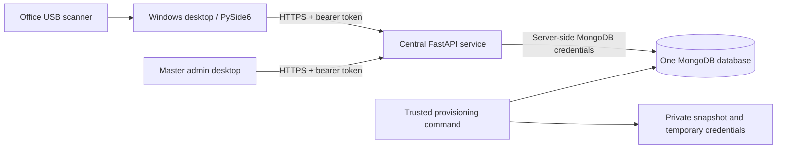

# Randaframes Attendance: Antigravity engineering handoff

Prepared: 19 October 2026. Release artifact version: **2.0.0**.

Workspace: `C:\Users\T470\Downloads\CODING\randaframes`

## 1. Read this first

The project has been changed from a Windows application that directly accessed MongoDB into a Windows application backed by a central authenticated HTTP API. The API owns office authorization, biometric matching and attendance writes. The existing MongoDB connection remains the intended single database.

**The Windows installer and server package have been built. This is not yet a deployed or fully accepted production system.** The database could not be reached because DNS resolution timed out. No live migration, account provisioning or employee reassignment was performed. No public service was deployed. The scanner SDK loaded, but it reported zero connected scanners, so physical enrollment and recognition were not verified.

The next agent should continue from this implementation, resolve deployment and hardware blockers, and review the explicitly identified limitations below. Do not tell the owner that office credentials already exist or that all offices are online.

Related documents:

- [DEPLOYMENT.md](DEPLOYMENT.md): operator installation and hosting instructions.
- [VERIFICATION.md](VERIFICATION.md): previous test/build evidence and its limits.
- [ANTIGRAVITY_START_HERE.md](ANTIGRAVITY_START_HERE.md): short continuation prompt.
- [release/SHA256SUMS.txt](release/SHA256SUMS.txt): original build hashes.

## 2. Owner's requirements and decisions

The owner requested an installable application for seven offices. Each office must log in, enroll its own staff and record check-ins/check-outs into one database. Office staff must not appear on other offices' systems. A master admin must see all records, grouped by location, with separate office categories where necessary.

The owner also requested passwords containing letters, numbers and symbols, described as “10 digits.” This was interpreted as **10-character temporary passwords**, not numeric-only passwords. User-chosen replacement passwords may be 10–128 characters.

Confirmed owner decisions:

| Decision | Agreed position |
| --- | --- |
| Existing staff ownership | **Engineering Kano**. This was explicitly confirmed by the owner. |
| Shared database | Use the existing MongoDB connection from `.env`. |
| Hosting preference | Keep the solution easy and lightweight. No hosting account or server access was supplied. |
| ngrok | Owner asked how to obtain a central server “like ngrok.” Trial instructions were supplied; ngrok was not configured. |
| Production readiness | Owner wants a robust client deliverable. This remains the target, not a claim that all acceptance checks passed. |

Office identifiers are fixed strings, defined in [src/offices.py](src/offices.py):

| Display name | Office ID / intended username | Location |
| --- | --- | --- |
| Engineering Kano | `engineering-kano` | Kano |
| Logistics Kano | `logistics-kano` | Kano |
| Logistics Bauchi | `logistics-bauchi` | Bauchi |
| Logistics Lagos | `logistics-lagos` | Lagos |
| Logistics Onitsha | `logistics-onitsha` | Onitsha |
| Logistics PH | `logistics-ph` | PH |
| Logistics Abuja | `logistics-abuja` | Abuja |

The owner's “Onishtia” spelling was normalized to **Onitsha**. PH remains the display/category abbreviation. Engineering Kano and Logistics Kano share a location category but have separate office IDs and permissions.

## 3. Before and after

| Area | Previous implementation | Current implementation |
| --- | --- | --- |
| Database connection | Desktop loaded MongoDB credentials. | Only the central service needs MongoDB credentials. Desktop uses HTTPS. |
| Startup | Built setup, kiosk and dashboard views; ran database migrations from desktop startup. | Starts at login; no desktop database migrations or unrestricted setup screen. |
| Authorization | UI/database queries did not consistently restrict offices. | Server derives office scope from the authenticated account. |
| Employees | All employees could be listed. | API scopes office reads and writes; master can manage all defined offices. |
| Fingerprint identification | Desktop loaded employee descriptors and compared locally. | Desktop extracts a probe; server compares only active enrolled employees in the authenticated office. |
| Fingerprint storage | Compressed Python pickle data. | Numeric descriptor arrays for new enrollments; restricted legacy conversion tool. |
| Attendance | Desktop supplied timestamps and wrote records. | Server supplies timestamps and handles duplicate actions. |
| Reporting | General unscoped report. | Location/office filters, grouped sheet, WAT display and CSV export. |
| Employee removal | Deleted employees and attendance history. | Deactivates employees while retaining history. |
| Scanner loading | Expected SDK at one developer-machine path. | Environment override, bundled runtime, then installed SDK discovery. |
| Distribution | Executable build copied `.env` into the output. | Installer bundles runtime/driver; `.env` and backend modules excluded. |

## 4. Architecture and trust boundaries



### Desktop responsibilities

- Show login, employee management, enrollment, reporting and scanner-terminal screens.
- Capture scanner images and calculate ORB descriptors with OpenCV.
- Send authenticated API requests and display confirmed results.
- Export the currently displayed report as CSV.
- Remember the server URL in `%LOCALAPPDATA%\RandaframesAttendance\client.json`.

Passwords and bearer tokens are not intentionally persisted by the desktop. The current token and user are held in memory. Restarting the app requires login.

### Server responsibilities

- Authenticate users, hash/verify passwords, issue/revoke/expire sessions.
- Check role and office ownership independently of desktop controls.
- Validate supported reads, employee updates and fingerprint samples.
- Match fingerprints within one office and write attendance using server time.
- Record selected audit events.
- Connect to MongoDB using the server's environment configuration.

### Why the shared database URI is not in the installer

A desktop with broad MongoDB credentials could bypass UI filters. Office isolation therefore lives in the API. All offices still use one database, but they access it through a service that enforces permissions.

Retiring old direct-database clients is part of the cutover. The new API does not prevent an old desktop or Android application from using previously distributed MongoDB credentials.

## 5. Authentication, passwords and permissions

Implementation: [src/server/security.py](src/server/security.py), authorization dependencies in [src/server/app.py](src/server/app.py).

### Passwords and sessions

| Setting | Implemented behavior |
| --- | --- |
| Temporary password length | Exactly 10 characters. |
| Generated character categories | At least one uppercase letter, lowercase letter, digit and symbol. |
| Symbol alphabet | `!@#$%&*?` |
| Randomness | Python `secrets` and `SystemRandom`. |
| Storage | Argon2 hashes in `users.password_hash`. |
| Replacement password | 10–128 characters, at least one letter, digit and allowed symbol. |
| First login | New/reset accounts must change the temporary password before protected operations. |
| Failed login policy | Five failed attempts trigger a 15-minute account lock. |
| Admin session | 12 hours. |
| Scanner-only session | 24 hours. |
| Token | Random bearer token; SHA-256 digest stored as session `_id`. |
| Session cleanup | MongoDB TTL index plus explicit expiry checks on each authenticated request. |
| Password change | Revokes the user's other sessions, keeps the current session. |
| Office password reset | Master-only; generates a new temporary password and revokes all target-office-account sessions. |

Generated passwords are not in this document, the repository or the installer. Provisioning has not run, so no new live credentials have been generated by this work.

### Role matrix

| Operation | Master admin | Office admin | Scanner-only session |
| --- | --- | --- | --- |
| View staff/reports | All defined offices | Own office | No |
| Add/edit staff | Select valid office | Own office only | No |
| Enroll fingerprint | Active employee in any office | Active employee in own office | No |
| Deactivate employee | Any accessible employee | Own office employee | No |
| Open scanner terminal | No; use an office login | Yes | Already restricted |
| Submit fingerprint scan | No | Own office | Own office |
| Change account password | Yes | Yes | No |
| Reset office password | Yes | No | No |

The retained legacy `line_manager` role is not accepted by the new login service. Existing line-manager accounts require an explicit account migration decision; they are not automatically converted.

Opening the scanner terminal issues a restricted token and deletes the previous admin session. Returning to management requires login again. The desktop clears dashboard tables on logout/terminal transition.

## 6. Desktop workflows

### Login

1. Enter the central service URL and office/master credentials.
2. The URL must use HTTPS; HTTP is accepted only for `localhost` and `127.0.0.1` testing.
3. Complete the forced password change when required.
4. Open the office or master dashboard.

URL validation rejects embedded username/password credentials, URL queries and fragments. HTTP redirects are not automatically followed. API requests use 5-second connection and 30-second read timeouts.

### Staff registration and enrollment

The employee dialog retains names, employee number, job title, department and photo. An office selector was added. Office admins receive only their office option; master admins can choose an office. The server independently enforces the office assignment.

Employee numbers remain globally unique under the existing schema/index. Changing an existing employee's office is explicitly blocked; no staff-transfer workflow was implemented. An existing inactive employee remains inactive when edited; there is no dedicated reactivation control in the current UI.

Enrollment attempts three captures, using the existing single-/dual-finger scanner capability logic. Locally extracted descriptors are submitted to the server for the selected active employee. The endpoint accepts one to three usable samples; it does not require that all three capture attempts produced valid descriptors.

### Master report

The dashboard includes:

- Active staff, checked-in-today and not-checked-in counts.
- Location and office filters.
- Date range and name/employee-number search; use **Refresh** to apply changed date/search values.
- A general attendance sheet sorted by location, office and date.
- Columns for location, office, name, employee number, job title, date, WAT time-in/time-out, minutes and status.
- CSV export of the displayed rows, with formula-prefix escaping.
- Master-only reset of the selected office's login password.

Export is **CSV**, not a newly implemented native `.xlsx` workbook. The absence KPI means “not checked in”; no full leave/holiday/absence scheduling subsystem was added. The new dashboard does not retain the previous SQLite-backup button. The legacy server-side backup utility remains in the repository.

### Attendance

The person selects Time In or Time Out and scans. The app shows success only after a central response confirms it. No offline queue, background upload or automatic replay of failed requests was implemented.

Time-in uses an atomic upsert with `$setOnInsert`; the unique employee/date index prevents duplicate daily records. Time-out conditionally sets the first clock-out time and calculates whole minutes worked. A repeated action returns “Already Timed In/Out.” Time-out before time-in returns an error.

This is one attendance record per employee per Nigerian calendar date. Multi-shift days and clock-out after an overnight shift are not implemented as a dedicated shift workflow.

## 7. API contract

API application: `src.server.app:app`. The client uses `src/client.py` rather than direct `pymongo` collections. MongoDB Extended JSON preserves ObjectIds, binary photos and dates over HTTP.

| Method/path | Authentication | Purpose |
| --- | --- | --- |
| `GET /health` | Public | Pings MongoDB and checks all seven office IDs exist. |
| `POST /login` | Public | Accepts username/password, returns token and safe user fields. |
| `POST /password` | Authenticated, non-kiosk | Changes password, including required first-login change. |
| `POST /logout` | Authenticated | Deletes current session. |
| `POST /kiosk` | Office admin | Replaces admin token with scanner-only token. |
| `POST /read` | Admin | Reads approved collections through server-enforced scope. |
| `POST /save` | Admin | Creates a department or creates/updates an employee. |
| `POST /employees/{employee_id}/fingerprint` | Admin | Enrolls validated numeric samples on an accessible active employee. |
| `POST /scan` | Office account, admin or kiosk session | Matches one probe in that office and records `in`/`out`. |
| `POST /offices/{office_id}/reset-password` | Master admin | Resets the office account and returns the temporary password once. |

Representative request shapes, using placeholders:

```json
{"username":"engineering-kano","password":"<private password>"}
```

```json
{"collection":"attendance_records","query":{"work_date":{"$gte":"2026-10-01","$lte":"2026-10-31"}}}
```

```json
{"collection":"employees","id":"<MongoDB ObjectId string>","document":{"status":"inactive"}}
```

Scan body: `{"samples": [descriptor_matrix], "action": "in"}`. Enrollment body: `{"samples": [matrix1, matrix2, matrix3]}`. Each matrix contains 20–2000 rows, 32 integer values per row, with values in 0–255.

### Implemented request restrictions

- `/read` allows only employees, attendance records, departments and offices. Account, session and audit collections are unavailable through it.
- Office scope is combined with the supplied query using `$and`, so a caller's office condition cannot replace it.
- Only a bounded set of query operators is accepted; `$where` is rejected.
- Fingerprint descriptor/sample fields are omitted from regular read responses.
- Reads over 50,000 records fail rather than silently truncate.
- Photos are limited to 2 MB; request bodies are limited to 6,000,000 bytes.
- Database errors return a generic 503 response rather than database credentials or raw exceptions.
- Normal responses carry `Cache-Control: no-store`.

Departments are a shared lookup collection. Their names are not separated per office. `/health` is a basic connectivity/provisioning check; it does not prove index integrity, account completeness or biometric readiness. Swagger/ReDoc pages are disabled; the default OpenAPI schema route was not explicitly disabled.

## 8. Database model and migration

### Collections

| Collection | Main changes/use |
| --- | --- |
| `offices` | Seven fixed string IDs, names and location categories. |
| `users` | Adds `office_admin` role and office association; existing master retained. |
| `employees` | Adds `office_id`; new `fingerprint_samples` representation; inactive status prevents future matching. |
| `attendance_records` | Adds `office_id`; server timestamps and minutes worked. |
| `sessions` | Hashed token IDs, user ID, expiry, optional `kiosk` flag. |
| `audit_events` | Selected actor/action/target/time records. |
| `departments` | Existing shared lookup, unique name. |
| `settings`, `schema_migrations` | Legacy infrastructure remains; new bootstrap is a separate entry point. |

Indexes established/ensured by `src/server/schema.py` include unique usernames, department names and employee numbers; employee office/status; attendance office/date; unique attendance employee/date; session expiry TTL; and audit timestamp. Existing user validator options are read and the allowed role enum is extended.

### Bootstrap order

Run from the trusted project/server folder, with access to the real `.env`:

```powershell
python scripts/check_database.py
python -m src.server.bootstrap --legacy-office engineering-kano
```

The bootstrap performs these steps:

1. Connect and ping the database before creating the credential file.
2. Exclusively create the credential CSV; refuse to overwrite an existing file.
3. Write a private pre-migration JSONL snapshot of existing collection documents.
4. Run initial-schema setup where needed and update indexes/role validation.
5. Seed all seven offices.
6. Assign employees missing `office_id` to Engineering Kano, then assign missing attendance-office fields from each associated employee.
7. Attempt restricted conversion of old fingerprint descriptors.
8. Create missing office accounts; preserve matching existing accounts.
9. Create `master.admin` only when no active master admin exists.
10. Write newly generated temporary passwords to the private CSV.

Default outputs:

```text
private/office-credentials.csv
private/pre-migration-YYYYMMDD-HHMMSS.jsonl
```

These paths are Git-ignored, but the application does not configure filesystem ACLs or encrypt these files. The operator must secure their storage and distribution.

### Migration edge cases for Antigravity

- **Not transactional:** snapshotting and migration are multi-step operations. Stop old writers and retain a full database backup. There is no automated rollback/restore command.
- The snapshot preserves BSON document types, but does not itself preserve database users, collection options or indexes as a complete native database backup would.
- Retrying after partial failure requires a different `--credentials` filename. Existing accounts are skipped, so the retry file contains only newly created account passwords.
- A username already belonging to a different role/office causes an explicit collision error. Resolve it deliberately; do not silently overwrite credentials.
- Legacy assignment targets missing `office_id`, not explicitly null/invalid values. Inspect nulls, unknown office IDs and orphan attendance before migration. The implementation assumes each employee has a usable office ID after assignment.
- Old master credentials are retained and are not automatically rotated or forced through a new complexity policy.
- New `2.0.0` timestamps use UTC and WAT display. **Old code wrote `datetime.now()` in several paths; this migration does not normalize legacy timestamp values.** Determine what timezone existing stored values represent before treating historical report times as correct. Blindly adding or subtracting one hour could corrupt data.
- Provisioning needs permission to modify collection validators/indexes; a narrowly restricted runtime database user may lack that permission.
- Health and isolated tests do not replace a real MongoDB schema/migration test.

## 9. Scanner and biometrics

### Files and discovery

The existing ctypes integration with Integrated Biometrics IBScanUltimate remains. Discovery order on Windows:

1. `IBSCAN_SDK_DIR`, when set.
2. Bundled `scanner_runtime` directory under the PyInstaller runtime root.
3. `C:\Program Files\Integrated Biometrics\IBScanUltimateSDK_x64\Bin`.

The DLL directory handle is retained so dependencies can load. The maintained bundle includes:

- `IBScanUltimate.dll`
- `ACamSDK.dll`
- `IBScanNFIQ2.dll`

Unused Java/demo/matcher DLLs were excluded after an initial build showed missing old Visual C++ runtime dependencies associated with those unused components.

The kiosk has a manual reconnect button and a single-shot five-second retry timer for hardware errors. Hiding/stopping it stops retry/countdown timers. The worker now handles a missing scanner, checks whether capture starts, cancels capture when stopped and cancels in its cleanup path. The provider closes an existing device before reinitializing it.

### Fingerprint representation and matching

The existing `FingerprintMatcher` uses OpenCV ORB and Hamming-distance matching. This was not replaced with a vendor-certified biometric algorithm. New templates are numeric arrays; the server never needs to unpickle data received from clients.

For a scan, the server obtains each active enrolled employee in the authenticated office, compares the probe against that employee's stored samples and ranks the best scores. A match needs a top score of at least 25 and, when a second candidate has a nonzero score, at least a six-point margin. The previous high-score shortcut that could accept an ambiguous match was not retained in the new server matching condition.

These numerical thresholds are implementation details, **not proof of an acceptable false-match/false-reject rate**. Automated tests mock matching scores for authorization checks. Actual matching needs genuine and unrelated finger samples, repeated captures, scanner reconnects and realistic staff counts.

The API trusts authenticated clients to submit descriptor probes. Hardware attestation, liveness detection and probe anti-replay protection are not implemented. A valid kiosk token is restricted to attendance submission, but it is not cryptographic proof that an input came from a physical scanner at that moment.

### Legacy templates

`src/server/legacy.py` uses a restricted unpickler allowing specific NumPy reconstruction types, with payload size, array shape and dtype checks. Successful conversions add numeric samples. Old descriptor bytes are retained by the conversion for recovery; fresh enrollment removes them. Failed conversions mark `has_fingerprint=False`, requiring re-enrollment.

### Actual hardware evidence

The local diagnostic returned:

```text
sdk_loaded: True
connected_scanners: 0
```

A successful SDK load is not an end-to-end scanner test. No claim was established that every supported office PC/USB configuration works.

## 10. File-by-file implementation map

### Application changes

| File | Work done |
| --- | --- |
| `main.py` | Replaced startup/migration/setup flow with authenticated client navigation; login, dashboard, kiosk transitions and cleanup. |
| `src/client.py` | New API transport, server URL persistence, BSON-aware encoding, in-memory session state and limited collection adapter. |
| `src/offices.py` | New canonical office definitions and lookup map. |
| `src/ui/login.py` | Server-address field, API login, forced password change, Enter-key login; removed unrestricted kiosk-back route from login layout. |
| `src/ui/dashboard.py` | Reworked master/office reporting, grouping, filters, staff actions, deactivation, password controls and CSV export. |
| `src/ui/add_employee.py` | Added office selection, expanded dialog, preserved inactive state on edits and routed writes through API adapter. |
| `src/ui/enrollment.py` | Submitted numeric samples to API, removed normal pickle enrollment storage, guarded hidden scans and cleaned timer/worker state. |
| `src/ui/kiosk.py` | Replaced database-wide local matching/writes with central scan submission, confirmation display and reconnect handling. The previous speech-greeting block was not carried into this replacement. |
| `src/data/repositories.py` | Switched GUI repository access to `ClientDatabase`. |
| `src/data/database.py` | Server-side explicit `.env` path, optional database-name variable and connection/socket timeouts; conditional TLS CA configuration. |
| `src/scanner/kojack.py` | Added portable DLL discovery/dependency-directory handling on top of existing user scanner changes. |
| `src/scanner/provider.py` | Closed stale devices before reinitialization; improved close behavior. |
| `src/scanner/worker.py` | Added missing-scanner/capture-start checks and cancellation cleanup, preserving existing capture work. |

### Central service

| File | Responsibility |
| --- | --- |
| `src/server/__init__.py` | Service package marker. |
| `src/server/app.py` | Routes, role/scope checks, validation, matching, attendance writes and audit events. |
| `src/server/security.py` | Password generation/verification, lockout and session issuance. |
| `src/server/schema.py` | New offices, role/index setup and legacy office assignment. |
| `src/server/bootstrap.py` | Controlled snapshot, migration and credential provisioning CLI. |
| `src/server/legacy.py` | Restricted conversion of old NumPy pickle descriptors. |

### Packaging, deployment and verification files

| File | Responsibility |
| --- | --- |
| `packaging/desktop.spec` | Maintained PyInstaller specification; bundles scanner capture runtime, excludes backend/tests. |
| `installer/setup.iss` | Inno Setup installer, shortcuts, admin requirement and driver MSI execution/error handling. |
| `scripts/build_windows.ps1` | Builds desktop, copies driver, finds Inno compiler, builds installer and prints its hash. |
| `build_exe.bat` | Delegates to the maintained build script; no longer copies `.env`. |
| `scripts/package_server.py` | Produces a clean server ZIP from an explicit file allowlist. |
| `scripts/check_database.py` | Sanitized connection diagnostic showing counts or exception type, not credentials. |
| `Dockerfile` | Python 3.12 slim API image; unprivileged runtime user; one Uvicorn worker. |
| `.dockerignore` | Limits build context to required server dependencies/source. |
| `compose.yaml`, `Caddyfile` | Optional VPS deployment with HTTPS proxy and persistent Caddy data. |
| `render.yaml` | Managed-host deployment definition with private MongoDB configuration and health check. |
| `start_server.bat` | Starts the service on loopback port 8000 for local/ngrok use. |
| `.env.example` | Placeholder configuration; no live URI or password. |
| `requirements-server.txt` | Server dependency set. |
| `requirements-desktop.txt` | Desktop/build dependency set. |
| `requirements-test.txt` | Combined testing dependencies. |
| `requirements.txt` | Existing general requirements extended for the new architecture. |
| `pytest.ini` | Restricts discovery to isolated tests rather than manual root-level hardware scripts. |
| `tests/test_office_security.py` | Nine API/security/migration/attendance tests. |
| `tests/test_desktop.py` | Three desktop/legacy-conversion tests. |
| `.gitignore` | Ignores private output, release files, local compiler/runtime/vendor staging and pytest cache files; allows maintained spec. |

Legacy files such as `src/services/auth.py`, `src/ui/setup.py`, root-level `.spec` files and `src/data/migrations.py` remain in the repository but are not the new application's active authentication/startup/build path. Do not make a future fix only in an unused legacy module.

`src/services/backup.py` still uses direct server-side MongoDB access. It was temporarily adapted during implementation and restored; the final content diff shows no intended functional change, although Git status may still show a line-ending-related modification.

## 11. Build artifacts

| Artifact | Purpose | Exact size at handoff |
| --- | --- | ---: |
| `release/RandaframesAttendance-Setup-2.0.0.exe` | Windows installer | 78,588,786 bytes |
| `dist/RandaframesAttendance/` | Unpacked PyInstaller desktop directory | Approximately 308.2 MB total |
| `release/server-package.zip` | Server-only source/configuration package | 18,577 bytes |
| `release/dashboard-preview.png` | Synthetic seven-office dashboard preview | 66,444 bytes |
| `release/SHA256SUMS.txt` | Installer/server archive checksums | 191 bytes |

Original SHA-256 values:

```text
94C7B3144CA12E55A43FC48B49F0DE492F5E1AC49A5BEB5F779B5150608C6FE1  RandaframesAttendance-Setup-2.0.0.exe
E17E0129E588D3FFE9C1DEA4EAFF82BDE4E80B92B7540F69E1FC0DD271B764D6  server-package.zip
```

These identify the existing build. Any rebuild or repackaging requires new hashes. This documentation handoff does not silently rebuild the application.

The server ZIP is not a full project/source backup. It intentionally omits the desktop, scanner binaries, tests and private data. The installer does not install the central API service. The desktop does not need Python installed separately.

### Installer details

The installer targets x64-compatible Windows, requires administrator rights, installs into Program Files and creates desktop/Start-menu shortcuts. The vendor driver MSI is run in the prepare-to-install stage. Exit 3010 requests a restart, 0 succeeds and 1638 is accepted as an already-installed version condition; other failure codes block installation with a message.

Do not assume this proves driver compatibility with Windows ARM64 just because the installer uses `x64compatible`. Test the actual office hardware/OS architecture. No fresh-PC installation, upgrade/uninstall sequence or driver rollback was performed in this session.

The installer is unsigned. No client code-signing certificate was supplied. Review vendor redistribution terms and the installer tooling's applicable commercial terms before external distribution. The compiler displayed a non-commercial-use banner; no commercial purchase or licensing activation was performed in this session.

### Build commands

```powershell
python -m pip install -r requirements-test.txt
python -m pytest -q
python -m compileall -q main.py src
powershell -NoProfile -ExecutionPolicy Bypass -File scripts/build_windows.ps1
python scripts/package_server.py
Get-FileHash release/RandaframesAttendance-Setup-2.0.0.exe -Algorithm SHA256
Get-FileHash release/server-package.zip -Algorithm SHA256
```

The local build used Python 3.14.5, PyInstaller 6.22.3 and Inno Setup 6.7.3. The Dockerfile targets Python 3.12; the image was prepared but was not built/run in this session. Dependency lists are partially version-bounded, not a complete reproducible lockfile.

The Windows build expects the vendor SDK Bin directory and a sibling Driver directory containing `IBScanDriver Setup.msi`. `IBSCAN_SDK_DIR` can override the Bin path. The local compiler is under ignored `tools/inno/`; another developer will need their own compiler installation or that local tooling separately.

## 12. Deployment and operating sequence

### Environment variables

| Variable | Used by | Meaning |
| --- | --- | --- |
| `MONGODB_URI` | Service/bootstrap | Real shared MongoDB connection; private. |
| `MONGODB_DATABASE` | Service/bootstrap | Defaults to `attendance_db`. |
| `ATTENDANCE_API_URL` | Desktop | Optional initial service URL; login UI can configure it. |
| `ATTENDANCE_DOMAIN` | Caddy/Compose | Public domain for VPS HTTPS. |
| `IBSCAN_SDK_DIR` | Scanner/build | Vendor SDK Bin directory override. |

### Recommended order

1. Inventory and preserve the working tree and old deployment.
2. Resolve MongoDB DNS/network/TLS/access-list issues without exposing its URI in logs or chat.
3. Test migration on a staging copy, including timezone and null-office inspection.
4. Select a stable service address and an owner-controlled host.
5. Stop old writers and take a full backup; run approved production bootstrap once.
6. Deploy the API and verify health, login and office isolation against the real database.
7. Pilot one office with physical hardware and a fresh Windows installation.
8. Deliver individual credentials privately; never send the full CSV to an office.
9. Install the same client at all offices and configure the same HTTPS URL.
10. Validate master reports and documented recovery procedures before retiring the old installation.

### ngrok trial

After provisioning and successful database diagnostics:

```powershell
start_server.bat
```

In a second terminal with the owner's ngrok account/agent already configured:

```powershell
ngrok http 8000
```

Use the HTTPS forwarding address in each desktop. The hosting PC, Python service and tunnel must remain running. A stable endpoint and reconnection behavior must be checked with the owner's chosen ngrok configuration. No token was supplied or stored by this work.

### Managed hosting / VPS

Render instructions and the Docker/Caddy VPS path are in [DEPLOYMENT.md](DEPLOYMENT.md). No provider account, payment, repository publication or DNS change was performed. Choose an always-on deployment appropriate to the office workload; review current provider settings/prices directly rather than assuming this handoff establishes them.

The service must reach the same MongoDB database. `/health` returns 503 when the seven office records are missing. The Docker path uses an unprivileged user for normal service operation; the documented one-off Compose bootstrap uses root so it can write the mounted private output directory. Secure ownership/access of those resulting files.

## 13. Test evidence and limitations

Last implementation test run: **12 passed**, approximately 19.25 seconds. No new application tests were required merely to write this handoff.

| Test | What it checks |
| --- | --- |
| `test_office_cannot_read_other_office_even_with_forged_query` | Office isolation despite caller filters; master visibility. |
| `test_forged_writes_enrollment_and_credentials_denied` | Cross-office write/enrollment denial and protected collections/reset endpoint. |
| `test_kiosk_token_cannot_manage_staff_or_change_password` | Restricted terminal permissions and invalidated previous admin token. |
| `test_attendance_is_idempotent_and_uses_nigerian_date` | Duplicate actions, minutes, WAT date boundary, cross-office report isolation. |
| `test_password_policy_lockout_expiration_and_reset` | Lockout, reset, revocation, forced change, policy and expired sessions. |
| `test_legacy_assignment_preserves_existing_offices` | Missing office assignment without moving already assigned employees. |
| `test_scan_matches_only_own_office_and_rejects_inactive_staff` | Office/inactive filtering with mocked matcher scores. |
| `test_query_code_and_unauthenticated_access_rejected` | Unauthenticated access and `$where` rejection. |
| `test_generated_passwords_are_ten_characters` | Generated length, character categories and sample uniqueness. |
| `test_dashboard_grouping_office_selection_and_clear` | UI grouping/restrictions/clearing and formatting helpers using mocked API data. |
| `test_main_window_starts_with_login_without_database` | Login-first desktop initialization without a real scanner/database. |
| `test_legacy_conversion_preserves_templates_and_rejects_code` | Supported template conversion, rerun behavior and forbidden pickle globals. |

Additional evidence:

- Python compilation succeeded.
- PyInstaller and Inno Setup builds succeeded.
- Embedded archive inspection found no backend modules or `src.data.database` in the desktop; `.env` was absent.
- Server ZIP allowlist was checked for absence of private credential files.
- Packaged executable remained running for a 12-second offscreen startup check, then the test process was stopped.
- Synthetic dashboard image was rendered and visually inspected.

These are not load tests, real-MongoDB validator/index tests, physical biometric tests, a fresh-PC installer test, a cloud deployment test or a penetration test. Remaining test warnings concerned a TestClient dependency deprecation and local pytest-cache write permissions.

## 14. Known gaps and review priorities

These are observed implementation boundaries or review items, not claims that each has already caused an incident.

| Priority | Item | Required next action |
| --- | --- | --- |
| P0 | Live database unreachable during work | Restore connectivity and verify the intended database before any migration. |
| P0 | No live office accounts or public service | Provision/deploy with owner-controlled access; hand out credentials only afterward. |
| P0 | No physical scanner acceptance | Validate real enrollment/matching and fresh-PC drivers before client handover. |
| P0 | Legacy timezone ambiguity | Inspect stored values and approve a timestamp normalization strategy before trusting historical times. |
| P0 | Old direct-database clients | Retire them and review credential rotation/network restrictions at cutover. |
| P1 | Account-based lockout only | Add/review gateway or service-level request/IP rate limits and abuse controls for public exposure. |
| P1 | No biometric liveness/attestation | Decide whether current ORB matching/probe trust meets the client's attendance requirements. |
| P1 | Synchronous network work in Qt UI | Slow API calls may freeze the interface until timeout. Move operations to background workers with clear state handling if needed. |
| P1 | No offline mode | Confirm reliable office internet, or design an explicitly authorized offline queue/reconciliation model. |
| P1 | Migration/audit are not transactional | Test partial failures and recovery; attendance and its audit event are separate writes. |
| P1 | Legacy bad/null office data | Add reviewed cleanup after inventory; do not silently assign arbitrary offices. |
| P1 | Matcher/report scalability | Matching is linear over office staff; reads/count adapters materialize data. Benchmark realistic volumes and introduce pagination/aggregation when needed. |
| P1 | No automated recurring backup/restore rollout | Configure provider backups, retention, recovery testing and monitoring. Existing SQLite utility is not a complete backup of users/templates/configuration. |
| P1 | Public API robustness | Review malformed BSON/sample payloads, complete employee schema validation and concurrent login/reset behavior against real infrastructure. |
| P1 | Packaging acceptance/licensing/signing | Verify fresh install, upgrade, driver restart/uninstall behavior, tooling/vendor terms and signing. |
| P2 | No staff transfer/reactivation workflow | Implement only after agreeing how historical office ownership should behave. |
| P2 | No shift scheduling/overnight model | Clarify if offices need multiple or overnight shifts before changing daily uniqueness. |
| P2 | Audit UI absent | Events exist in the database, but no audit browsing dashboard was added; login attempts are not comprehensively audited. |
| P2 | Legacy modules/manual scripts remain | Identify active vs obsolete paths before cleanup; do not accidentally restore direct database access to clients. |
| P2 | No dependency lock/CI deployment pipeline | Pin tested versions and automate meaningful build/integration checks. |

The master dashboard filters the seven defined office IDs. Invalid/unassigned office records are not automatically exposed in a special master “unassigned” category; inventory them directly through trusted migration tooling.

## 15. Working-tree ownership and handoff safety

No commit, push or PR was made during this work. Many new files are untracked. **A normal checkout of the previous repository commit will not contain this implementation.** Transfer/review the actual working tree or create a reviewed commit before another machine continues.

The following changes were present before this work began:

```text
Modified:
  src/scanner/kojack.py
  src/scanner/worker.py
  src/ui/enrollment.py
  src/ui/kiosk.py
  test_scanner.py
  test_scanner_gui.py

Untracked:
  captures/
  test_scanner.bat
```

The four application/scanner files were subsequently adapted for the new architecture, so their full Git diffs combine pre-existing user work with new work. The root scanner test scripts/capture files were not authored as part of this implementation. Do not discard them with a blanket reset or claim every line in their diffs as new work.

There are old build outputs under `dist/WorkplaceAttendance` and an `android_app` directory. The Android app was not migrated or packaged in this work. Review all tracked files before publishing a repository; a `.gitignore` change does not remove already tracked content or credentials from history.

Ignored folders such as `release/`, `tools/`, `installer/vendor/`, `scanner_runtime/` and `private/` will not be included automatically in a normal Git handoff. Share necessary build artifacts through an appropriate private channel, and keep database/credential material separate.

## 16. Definition of done for the continuation

The remaining work is complete only when there is evidence of:

- A stable owner-controlled HTTPS endpoint connected to the intended single MongoDB database.
- A backed-up, verified Engineering Kano legacy migration with historical time semantics resolved.
- Seven working office logins and a master login, with private credential delivery and forced password changes verified.
- Real server-side isolation tests covering Abuja, Engineering Kano and Logistics Kano after deployment.
- Physical enrollment, positive/negative fingerprint identification, in/out, repeated scan, USB reconnect and service/network restart tests.
- Fresh Windows installation and driver verification on the actual office hardware architecture.
- Correct master categories, WAT reports and exported rows for real sample records.
- An accepted backup/restore, monitoring and recovery procedure.
- An explicit owner decision on any remaining online-only, biometric, shift or operational limitations.

Until then, describe the outcome as a built implementation and installer awaiting rollout validation, not a completed seven-office live deployment.
